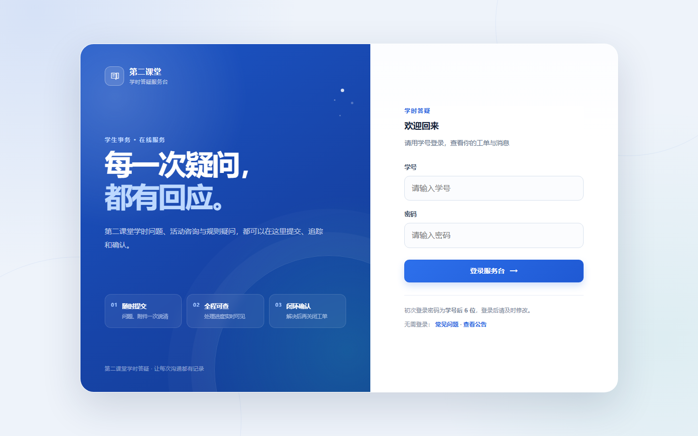

# 第二课堂学时答疑服务台

> 把「学时没录上」的群聊刷屏，变成可追踪、可统计的工单。

**在线演示：<http://<你的服务器IP>:8080>**

| 角色 | 演示账号 | 密码 |
|---|---|---|
| 学生 | 2023001001 | 123456 |
| 干事（学部） | 2023002001 | 123456 |
| 管理员 | 2023003001 | 123456 |

> 演示库为脱敏测试数据；服务器为个人学生机，若打不开请见下方「已知不足」。

## 界面



<!--
⚠️ 补两张截图后取消注释，并把文件名对上：


截图建议 1440×900、隐藏滚动条，只截内容区（别截整个桌面和浏览器标签栏）。
-->

---

## 这个系统解决什么问题

第二课堂学时的答疑原本发生在微信群：学生问「我的活动学时为什么没录上」，干事在几百条消息里翻找，同一个问题被问十几次，处理完也没有记录，学期末统计只能靠人工回忆。

本项目把这条链路产品化：

```
学生提交工单（附证明材料）→ 干事接单并回复 → 学生确认或追问 → 管理员看统计
                     ↑ 重复问题自动关联 / 常见问题优先展示
```

## 三类角色能做什么

**学生**：提交工单（文字 + 最多 5MB 附件）、查看进度、追问、确认完成、查常见问题、看公告

**干事（STAFF）**：待办队列、接单、回复、使用快捷回复模板、合并重复工单、关闭工单

**管理员（ADMIN）**：用户管理、工单总览、常见问题维护、公告、敏感词、快捷回复模板、操作日志、数据导出、统计看板

## 技术栈

- **后端**：Spring Boot 4.1.1 / Java 17 / Maven
- **数据**：MySQL 8（**13 张表**）、Redis
- **鉴权**：JWT（HS512）+ 拦截器；登出后 Token 进 Redis 黑名单
- **前端**：原生 HTML/CSS/JS（`app.js` 约 200 KB，无前端框架）
- **规模**：105 个 Java 文件 / 8,831 行；**18 个控制器 / 52 个接口方法**；16 个服务类
- **部署**：阿里云 + nginx + systemd；带备份脚本与部署手册（`deploy/`）

## 我做的几个判断，以及为什么

**1. 为什么不做小程序，而做 H5 + 一个链接**

小程序要审核、要主体资质，校园内部工具走不通；H5 发一个链接就能用，装机成本为 0，这也是能在一周内被真实使用的前提。

**2. 为什么工单要有「已解决待确认」这个中间态**

只有「完成」一个状态，学生没确认就被关单，学期末的统计会把「没解决」算成「已解决」。加了确认态之后，闭环率才可信。

**3. 为什么敏感词和登出黑名单放 Redis 而不是 MySQL**

两者都在高频路径上：提单每次都要过敏感词，每个请求都要查黑名单。走数据库会把这两个操作变成瓶颈，而 Redis 的 TTL 天然匹配 Token 的剩余有效期。

**4. 为什么附件限制从「只允许图片」放宽到图片 + PDF + Office + 压缩包**

学时申诉常需要上传证明材料（截图、通知文件、表格），只收图片会把用户逼回微信。这是与需求方确认后对原始设计的主动偏离。

**5. 为什么探活接口把超时压到 2–3 秒**

`/health` 自己变成一个卡 30 秒的组件时，监控就失效了。所以连接超时、Redis 命令超时全部显式收紧，Redis 挂了要「快速失败」而不是拖死探活。

## 接口与数据

- 表结构：`schema.sql`（13 张表，含工单、消息、附件、常见问题、公告、合并关系、状态日志、操作日志、快捷回复、通知日志、敏感词）
- 接口自测：`requests.http`（可直接在 IDEA / VS Code REST Client 里跑）
- 健康检查：`GET /health` 返回 DB / Redis 状态，任一挂了整体报 DOWN + 503

## 本地运行

前置：JDK 17、MySQL 8、Redis。

```powershell
# 1) 建库并导入表结构与种子数据
mysql -uroot -p -e "CREATE DATABASE second_classroom DEFAULT CHARSET utf8mb4"
mysql -uroot -p second_classroom < schema.sql
mysql -uroot -p second_classroom < deploy/seed.sql

# 2) 准备本地凭据（不进版本库）
copy config\application-local.yml.example config\application-local.yml
#    然后编辑 config/application-local.yml，填入数据库密码与本地 JWT 密钥

# 3) 启动
.\mvnw.cmd spring-boot:run
```

浏览器打开 <http://localhost:8080>，用上面的演示账号登录。

> 配置读取顺序：`application.yml`（占位符 + `optional:file:./config/application-local.yml`）
> → 本地文件提供真实值 → 生产用 `--spring.profiles.active=prod` 走环境变量。

## 生产部署

```bash
java -jar second-classroom-0.0.1-SNAPSHOT.jar --spring.profiles.active=prod
# 必填环境变量：DB_PASSWORD / JWT_SECRET / UPLOAD_DIR
```

完整步骤见 [`deploy/DEPLOY.md`](deploy/DEPLOY.md)：nginx 反代、systemd 托管、备份脚本、回滚。

## 已知不足

- **没有自动化测试**：接口靠 `requests.http` 手工验收，回归靠人
- **单机部署**：没有做多实例与文件存储的横向扩展（附件落本地磁盘）
- **附件未做病毒扫描**，仅限制扩展名与大小
- **通知是轮询派发**（扫 `t_notification_log` 的 PENDING），没有接入真实推送通道
- **移动端只适配到 390px 宽**，未做平板布局
- 演示服务器为个人学生机，带宽小、可能到期下线

## 开发说明

<!-- ⚠️ 如实填写这一段：面试官一定会问「哪些是你写的」 -->

本项目为个人独立项目。开发过程中使用 AI 编码助手辅助生成代码；需求梳理、接口与表设计、验收测试、部署上线由本人完成。

（如果实际情况与上面不符，请按真实情况改写这段——写清楚你负责哪部分、AI 负责哪部分，比含糊带过更可信。）

## 目录结构

```
src/main/java/com/secondclassroom/
├── controller/   18 个控制器（学生端 / 干事端 / 管理端 / 认证 / 文件 / 健康检查）
├── service/      16 个服务类（业务、统计、导出、通知派发、敏感词、重复检测）
├── interceptor/  JWT 鉴权拦截器
├── common/       统一返回、异常处理、Token 黑名单
└── util/         JWT 工具
src/main/resources/
├── static/       前端（index.html / app.js / api.js / app.css）
├── application.yml          开发配置（密钥用占位符）
└── application-prod.yml     生产配置（全部走环境变量）
schema.sql        建表语句（13 张表）
requests.http     接口自测集合
deploy/           部署手册、nginx 配置、systemd 服务、备份脚本
```

## License

个人项目，仅用于学习与校园内部使用。
